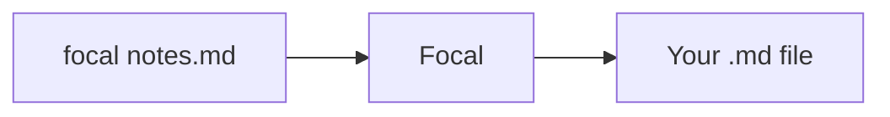

# Welcome to Focal

Focal shows Markdown the way it reads. **Bold** is bold, `code` is code, and [this project](https://github.com/niklas-heer/focal) is a link. Put the caret into a word and its syntax appears. Move away and it hides again.

This is an untitled document. Type in it freely. Save it as a file when you want to keep it.

## Try it

- [ ] Tick this box with a click
- [ ] Put the caret into **this word** and look at its asterisks
- [ ] Press Return at the end of this line to start a new item

## Shortcuts for the basics

| Format | Shortcut |
| :-- | --: |
| Bold | ⌘B |
| Italic | ⌘I |
| Link | ⌘K |
| Heading | ⌘1 to ⌘6 |

## A formula

Math is typeset as you write:

$$
e^{i\pi} + 1 = 0
$$

## A diagram

## Getting around

- Move the pointer to the bottom edge of the window for the formatting bar.
- ⌘D turns on focus mode, which dims everything but the paragraph you are writing.
- ⌘P opens the quick switcher, to jump between the notes in a folder.
- ⇧⌘O goes to a heading.
- ⌘Y views the image at the caret. Esc closes it.
- ⌘, opens Settings.
- In Terminal, `focal notes.md` opens a file and `focal ~/Notes` opens a folder. Settings can install the `focal` command.
